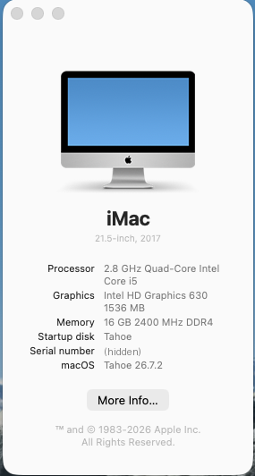
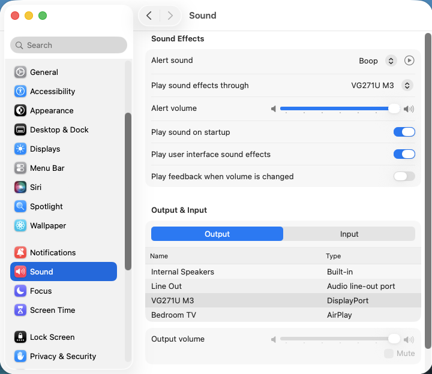
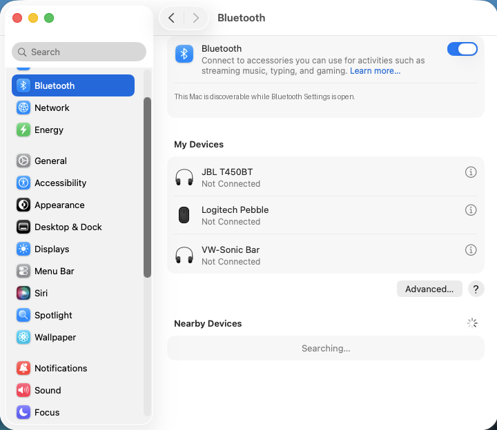

# HP EliteDesk 800 G3 Mini – macOS Tahoe 26 (OpenCore)

OpenCore EFI for the **HP EliteDesk 800 G3 Mini (Desktop Mini)** running **macOS Tahoe 26.7.2** with working **onboard audio**, **WiFi**, **Bluetooth** and **OTA updates**. No root patches.

> [!IMPORTANT]
> Before you boot this EFI:
> 1. **Generate your own SMBIOS** (see [SMBIOS](#smbios)). The serial fields are placeholders.
> 2. **Add SimpleHDA for audio on Tahoe** (see [Audio on Tahoe](#audio-on-tahoe-simplehda)). It isn't included in this repo.

## Download

The EFI is split into two files to stay under GitHub's upload size limit:

1. **[EFI.zip](EFI.zip)**: the whole EFI except the WiFi kext.
2. **[itlwm-kext.zip](itlwm-kext.zip)**: the WiFi kext (`itlwm.kext`). It's large because it bundles firmware for every Intel WiFi card.

Unzip both, copy `itlwm.kext` from the second zip into `EFI/OC/Kexts/`, then copy the `EFI` folder to your EFI partition. **OpenCore won't boot without itlwm.kext in place**, because the config expects it.



## Hardware

| Component | Model |
|---|---|
| Machine | HP EliteDesk 800 G3 Mini (35 W) |
| CPU | Intel Core i5-7600T (Kaby Lake) |
| iGPU | Intel HD Graphics 630 |
| RAM | 16 GB DDR4-2400 SO-DIMM (2 × 8 GB, dual channel) |
| Storage | NVMe M.2 SSD (macOS) + SATA SSD (Windows) |
| Audio | Conexant CX20632, shown as "Synaptics HD Audio" in Windows (`14F1:5098`, `alcid=20`) |
| Ethernet | Intel I219-LM |
| WiFi / Bluetooth | Intel AX200NGW, added to the empty M.2 WLAN slot |

## Software

- **macOS:** Tahoe 26.7.2 (updated OTA from 26.7.1)
- **OpenCore:** 1.0.7
- **SMBIOS:** iMac18,1, with `-no_compat_check` and RestrictEvents `revpatch=sbvmm` so Software Update works

## Status

**Working**

- [x] HD 630 graphics acceleration (1536 MB), DisplayPort output
- [x] Audio via SimpleHDA: internal speaker, line out, DisplayPort audio
- [x] WiFi: Intel AX200 via itlwm + HeliPort
- [x] Bluetooth: Intel AX200, including Bluetooth LE devices (Logitech Pebble) and A2DP headphones
- [x] Sleep / wake
- [x] OTA macOS updates (26.7.1 → 26.7.2 tested)
- [x] Ethernet
- [x] Dual boot with Windows from the OpenCore picker

**Not working**

- [ ] AirDrop, Handoff, Continuity, Sidecar, iPhone Mirroring (Intel WiFi has no AWDL)
- [ ] Volume slider for DisplayPort audio (a macOS limitation; use MonitorControl)

## Kexts

| Kext | Version | Purpose |
|---|---|---|
| Lilu | 1.7.2 | Patching framework |
| VirtualSMC, SMCProcessor, SMCSuperIO | 1.3.7 | SMC emulation and sensors |
| WhateverGreen | 1.7.0 | iGPU |
| AppleALC | 1.9.7 | Audio layout (`alcid=20`) |
| SimpleHDA | 1.0.0 | **Not included; download it separately.** Restores AppleHDA on Tahoe; loads only on Darwin 25 |
| RestrictEvents | 1.1.4 | `revpatch=sbvmm` for OTA updates |
| NVMeFix | 1.1.3 | NVMe power management |
| IntelMausiEthernet | 3.0.0 | Intel I219-LM |
| USBMap | – | Custom USB map, includes **HS14** for internal Bluetooth |
| itlwm | 2.3.0 | Intel WiFi (use with [HeliPort](https://github.com/OpenIntelWireless/HeliPort)) |
| IntelBluetoothFirmware, IntelBTPatcher | 2.5.2 | Intel Bluetooth ([emulatorchen fork](https://github.com/emulatorchen/IntelBluetoothFirmware), `2.5.2-dlc-fix`) |
| BlueToolFixup | 2.7.2 | From BrcmPatchRAM, required on Monterey and later |

ACPI: `SSDT-PLUG-DRTNIA`, `SSDT-EC-USBX-DESKTOP`.
Drivers: OpenRuntime, OpenCanopy, HfsPlus, ResetNvramEntry. The GUI picker uses the Acidanthera GoldenGate theme.

## Boot arguments

```
keepsyms=1 alcid=20 igfxonln=1 -lilubetaall -no_compat_check revpatch=sbvmm shda-lang=en
```

- `keepsyms=1` is required by SimpleHDA.
- `shda-lang=en` shows audio device names in English (otherwise they can appear in Chinese).

## Audio on Tahoe (SimpleHDA)

Apple removed AppleHDA in Tahoe. [SimpleHDA](https://github.com/laobamac/SimpleHDA) by laobamac restores it through OpenCore, with no system volume patches. It contains Apple's AppleHDA binary, so it isn't redistributed here.

1. Download `SimpleHDA-Tahoe-v1.0.0-RELEASE.zip` from the [SimpleHDA releases](https://github.com/laobamac/SimpleHDA/releases).
2. Copy `SimpleHDA.kext` to `EFI/OC/Kexts/`.
3. In `config.plist` → `Kernel → Add`, set **Enabled = true** for `SimpleHDA.kext`. The entry is already there, after Lilu and AppleALC, with `MinKernel 25.0.0`.
4. Optional: once you're in Tahoe, install `SimpleHDA-HAL-1.0.0.pkg` from the same zip, then reboot.

Tested with the Conexant CX20632: internal speaker, line out and DisplayPort audio all work, and audio survived the 26.7.1 → 26.7.2 update.



## BIOS settings (F10)

| Setting | Value |
|---|---|
| Secure Boot Configuration | **Legacy Support Disable and Secure Boot Disable** (HP asks you to type a 4-digit code on the next boot; if you skip it, the setting reverts) |
| Virtualization Technology for Directed I/O (VT-d) | Off |
| Configure Storage Controller for Intel Optane | Off |
| M.2 WLAN/BT | On |
| Video memory size | 64 MB or more (128 MB recommended) |
| UEFI Boot Order | M.2 SSD (OpenCore) above Windows Boot Manager |

## Lessons learned

1. **Bluetooth on the M.2 WLAN card is on internal USB port HS14.** If your USB map doesn't include HS14, macOS can't see the Bluetooth chip. On Windows, Device Manager → Intel Wireless Bluetooth → Details → *Location paths* shows `ACPI(HS14)`. HS14 is mapped as internal (type 255) here.
2. **IntelBTPatcher 2.4.0 (official) kernel panics on recent macOS** (`IOGMD: not wired for the IODMACommand`, process `bluetoothd`). The 2.5.2 build from the emulatorchen fork fixes it. Without IntelBTPatcher, Classic Bluetooth works but LE devices such as mice fail to connect.
3. **A BIOS reset to 32 MB video memory panics the HD 630 framebuffer** (`AppleIntelKBLGraphicsFramebuffer FBMemMgr_Init`). This EFI includes `framebuffer-stolenmem` (19 MB) and `framebuffer-fbmem` (9 MB) patches, so it boots even at 32 MB.
4. **A weak CMOS battery silently resets the BIOS**, which also turns Secure Boot back on. Symptom: POST error *005 Real-Time Clock Power Loss*, after which OpenCore won't start and the firmware gives no message. Replace the CR2032 with a good brand.
5. **The AX200 uses MHF4 (IPEX4) antenna connectors**, not U.FL. Many "M.2 NGFF" antenna kits ship U.FL. The rear antenna holes take RP-SMA bulkheads, so you need **RP-SMA male** antennas (centre hole, not centre pin). 30 cm pigtails reach the rear holes.
6. **iMac18,1 isn't officially supported on Sonoma or later.** `-no_compat_check` lets it boot, and RestrictEvents `revpatch=sbvmm` makes Software Update offer updates.
7. **If OpenCore falls back to Windows**, it's usually because the default boot entry was removed. Highlight macOS in the picker and press **Ctrl+Enter**. If Windows keeps moving itself above OpenCore in the BIOS boot order, set `Misc → Boot → LauncherOption` to `Full`.



## SMBIOS

Generate your own with [GenSMBIOS](https://github.com/corpnewt/GenSMBIOS) for **iMac18,1**, then fill in `PlatformInfo → Generic`:

- `SystemSerialNumber`
- `MLB`
- `SystemUUID`
- `ROM` (your Ethernet MAC address, without colons)

Check that the serial is **not valid** on Apple's coverage checker before using it. Edit `config.plist` with [ProperTree](https://github.com/corpnewt/ProperTree).

## Installation notes

- Install Tahoe on its own APFS volume, or update from Sequoia.
- After installing, add **HeliPort** to Login Items so WiFi connects at startup.
- Turn automatic macOS updates off, and check sound after each major update in case SimpleHDA needs updating.
- Keep a working copy of your EFI on a USB stick.

## Support

Provided **as-is** for learning and personal use. It works on my machine, but I can't guarantee it will on yours, and I may not be able to answer every question. Use at your own risk, and keep a backup EFI.

## Credits

Acidanthera (OpenCore, Lilu, WhateverGreen, AppleALC, VirtualSMC, RestrictEvents, BrcmPatchRAM, NVMeFix) · OpenIntelWireless (itlwm, HeliPort, IntelBluetoothFirmware) · emulatorchen (IntelBluetoothFirmware fork) · laobamac (SimpleHDA) · Mieze (IntelMausiEthernet) · corpnewt (GenSMBIOS, ProperTree) · Dortania guides.
